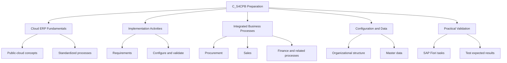
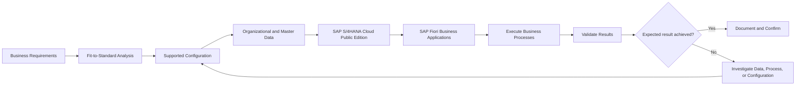
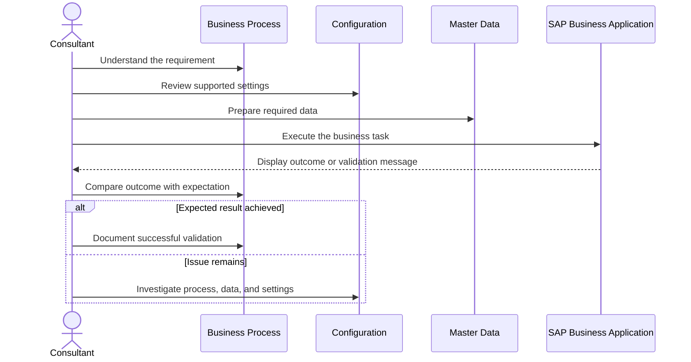
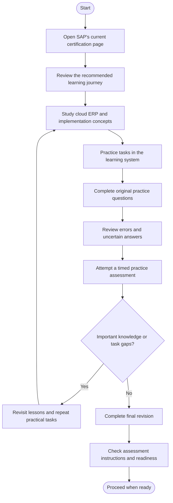
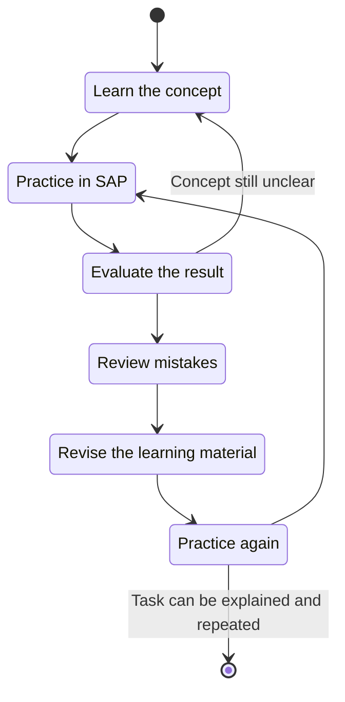
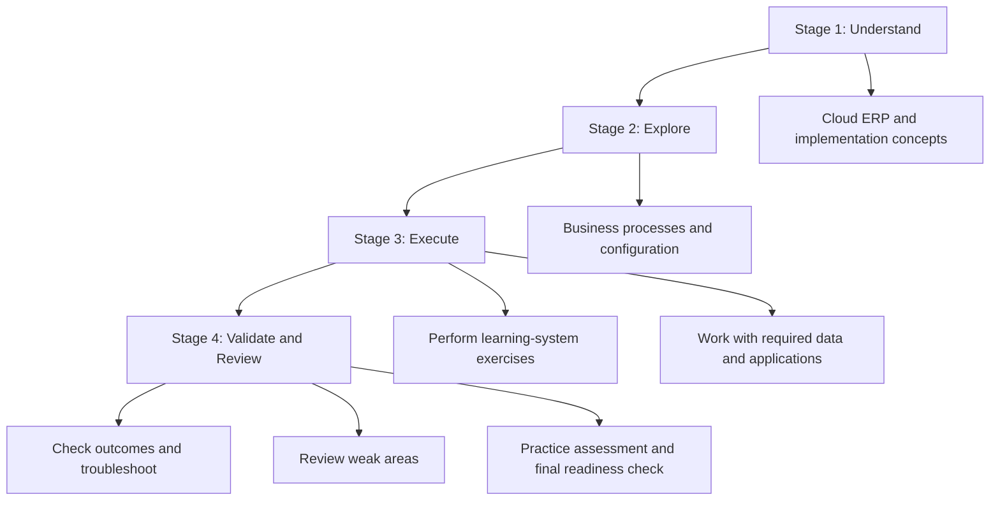

# SAP S/4HANA Cloud Public Edition — C_S4CPB Study Guide

A practical, hands-on study guide for the **SAP Certified Implementation Consultant – SAP S/4HANA Cloud Public Edition** certification (C_S4CPB). This repository helps learners organize their preparation around cloud ERP concepts, implementation activities, business processes, system configuration, and practical assessment skills.

The goal is to build an understanding of how SAP S/4HANA Cloud Public Edition is implemented and operated—not simply to memorize terminology. Use the official SAP learning journey as your primary resource, practice the relevant tasks in an authorized learning system, and use the diagrams and exercises in this guide to structure your revision.

> **Certification note:** SAP's certification catalog lists C_S4CPB as a system-based assessment with a three-hour duration and a 69% pass score. Certification formats and requirements can change, so check the official certification page before you begin or schedule your assessment.

- **Official certification page:** [SAP Certified – Implementation Consultant, SAP S/4HANA Cloud Public Edition](https://learning.sap.com/certifications/sap-certified-associate-implementation-consultant-sap-s-4hana-cloud-public-edition)
- **Supplementary preparation:** [CertsGate](https://certsgate.com/)

## Table of Contents

- [About the Certification](#about-the-certification)
- [Who Should Use This Guide?](#who-should-use-this-guide)
- [Exam Information](#exam-information)
- [Skills and Knowledge Areas](#skills-and-knowledge-areas)
- [Conceptual Skills Map](#conceptual-skills-map-not-official-weighting)
- [SAP S/4HANA Cloud Implementation Architecture](#sap-s4hana-cloud-implementation-architecture)
- [Implementation Workflow](#implementation-workflow)
- [Preparation Flowchart](#preparation-flowchart)
- [Circular Study Cycle](#circular-study-cycle)
- [Step-by-Step Preparation Guide](#step-by-step-preparation-guide)
- [Suggested Study Roadmap](#suggested-study-roadmap)
- [Practice Questions](#practice-questions)
- [Hands-On Projects](#hands-on-projects)
- [Common Preparation Mistakes](#common-preparation-mistakes)
- [Career Relevance](#career-relevance)
- [Frequently Asked Questions](#frequently-asked-questions)
- [Official and Additional Resources](#official-and-additional-resources)
- [About CertsGate](#about-certsgate)

## About the Certification

SAP S/4HANA Cloud Public Edition is SAP's public-cloud ERP offering. It supports integrated business processes and provides a standardized cloud environment that organizations can adopt and configure according to supported business requirements.

The C_S4CPB certification is intended for implementation project members who need to understand and carry out core implementation activities. Preparation should connect the concepts behind cloud ERP with practical tasks performed in the SAP learning environment.

An implementation consultant may need to understand how business requirements map to standard processes, how configuration choices affect those processes, how organizational and master data support transactions, and how to validate a configured solution.

The precise learning content and assessment requirements should always be taken from SAP's current certification page and its recommended learning journey.

## Who Should Use This Guide?

This study guide is useful for:

- Aspiring SAP S/4HANA Cloud Public Edition implementation consultants.
- SAP functional consultants moving toward public-cloud implementations.
- ERP professionals learning standardized cloud implementation approaches.
- Project team members involved in configuration, testing, and process validation.
- Business process specialists who want to understand SAP cloud implementation work.
- Learners preparing for the C_S4CPB system-based assessment.

A basic understanding of enterprise business processes and ERP terminology is helpful. Familiarity with finance, procurement, sales, or another business area can make the examples easier to understand, although the exact prerequisites should be checked on SAP's official page.

## Exam Information

| Item | Current published information |
|---|---|
| Certification provider | SAP |
| Certification | SAP Certified – Implementation Consultant, SAP S/4HANA Cloud Public Edition |
| Exam code | C_S4CPB |
| Catalog version | CertsGate currently lists C_S4CPB_2602; verify the version shown by SAP |
| Assessment type | System-based assessment |
| Duration | 3 hours |
| Pass score | 69% |
| Official certification page | [SAP Learning](https://learning.sap.com/certifications/sap-certified-associate-implementation-consultant-sap-s-4hana-cloud-public-edition) |

The details above are based on the linked SAP certification listing. The exam code displayed by SAP, assessment instructions, available attempts, and applicable requirements should be checked directly before scheduling.

### Understand the System-Based Assessment

SAP's newer certification approach emphasizes demonstrating practical skills in addition to knowing concepts. The official SAP guide explains that system-based tasks are connected to practical exercises in the relevant learning journey.

For preparation, this means that reading alone is not enough. Practice the tasks in the recommended learning environment, learn where the relevant configuration and business applications are located, and verify the result of each activity.

Official guidance: [SAP Certification System-Based Exams Guide](https://www.sap.com/documents/2026/03/de16e2e2-437f-0010-bca6-c68f7e60039b.html)

## Skills and Knowledge Areas

Use the following areas to organize your learning. They are a **study framework**, not a claim that these are the complete official exam objectives or that each area has a particular exam weight.

### 1. Cloud ERP Fundamentals

Understand what public-cloud ERP provides and how it differs from other deployment approaches. Learn why standardized processes, supported configuration, cloud operations, and regular updates influence implementation decisions.

Study questions to consider:

- What does an organization gain from a standardized cloud ERP?
- How do public-cloud and private-cloud deployment models differ?
- Why should consultants check supported extensibility and configuration options?

### 2. Implementation Approach

Learn the purpose of a structured implementation methodology and how project activities connect.

Focus on:
- Understanding business requirements.
- Mapping requirements to standard processes.
- Organizing configuration and validation activities.
- Identifying gaps that need further analysis.
- Testing the solution before business use.

Use SAP's recommended learning journey to identify the exact methodology and tasks expected for the current certification.

### 3. Business Processes

SAP S/4HANA Cloud Public Edition integrates processes across business functions. Understand how activities connect instead of studying each transaction in isolation.

Examples include:
- Procurement from a purchasing requirement through receipt and invoice processing.
- Sales from an order through delivery and billing.
- Finance activities involving master data, journal entries, and financial reporting.
- Organizational and master data used across business transactions.

The exact processes to prioritize should follow SAP's current learning content.

### 4. Configuration and Organizational Structure

Understand how configuration supports business operations and how organizational structures and master data influence transaction processing.

Practice identifying:
- The business requirement behind a configuration choice.
- The organizational data needed for a scenario.
- The dependencies between configuration and master data.
- The expected outcome of a configuration change.

### 5. SAP Fiori and Business Applications

Become comfortable navigating the SAP Fiori user experience used in the learning environment. Learn how to locate relevant applications, enter data, inspect results, and verify whether an activity completed successfully.

Do not rely on memorizing application names alone. Understand the business task each application supports.

### 6. Testing and Validation

Implementation work requires evidence that a process behaves as expected. Learn to check results, identify missing prerequisites, and distinguish a configuration problem from a data-entry or process issue.

For each exercise, record the expected result, the actual result, and how you confirmed the outcome.

## Conceptual Skills Map (Not Official Weighting)

SAP's certification page should be used for the authoritative learning topics. The diagram below is an independent study overview and does not represent official domain percentages.

Use the map to find areas that need review, then cross-check your list against SAP's recommended learning journey.

## SAP S/4HANA Cloud Implementation Architecture

The following conceptual diagram illustrates how business requirements, standard processes, configuration, master data, business applications, and validation relate to an implementation. It is a learning model, not a diagram of SAP's internal infrastructure.

### What This Diagram Teaches

- **Business requirements:** Define the operational outcome the organization needs.
- **Fit-to-standard analysis:** Checks whether a supported standard process meets the requirement.
- **Configuration:** Adapts supported system behavior to the agreed business process.
- **Organizational and master data:** Supplies the structure and information needed for transactions.
- **Business applications:** Let users perform tasks in the system.
- **Validation:** Confirms whether the process produced the expected outcome.

A strong consultant understands the relationship between these elements. When a transaction fails, the solution is not always to change configuration; the cause may be missing master data, incorrect input, or an unmet process prerequisite.

## Implementation Workflow

Use this sequence to practice an end-to-end implementation scenario in a learning system.

The most valuable part of this workflow is the feedback loop. Consultants should be able to explain why a task succeeded or failed and what evidence supports their conclusion.

## Preparation Flowchart

Follow a structured process rather than studying topics randomly. If a lab or practice assessment exposes a gap, return to the relevant learning material before moving forward.

## Circular Study Cycle

Preparation for a system-based assessment should be iterative. Read the concept, perform the task, evaluate the result, investigate mistakes, and repeat until you can complete the work with understanding.

A task is not fully learned just because it worked once. Make sure you understand its prerequisites, the expected result, and how to recognize common problems.

## Step-by-Step Preparation Guide

### Step 1: Confirm the Current Certification Requirements

Start with the official [C_S4CPB certification page](https://learning.sap.com/certifications/sap-certified-associate-implementation-consultant-sap-s-4hana-cloud-public-edition).

Confirm the displayed code, assessment type, time limit, pass score, recommended learning journey, and any prerequisites. If SAP has updated the learning content, use the current version rather than relying entirely on older notes.

### Step 2: Review the Learning Journey

Use SAP's official learning content as your syllabus. Turn each lesson and practical exercise into a checklist.

For every topic, record:
- What the concept means.
- Which business problem it addresses.
- Which system task demonstrates it.
- What prerequisites the task requires.
- How to verify the result.

This approach turns a broad learning journey into an actionable study plan.

### Step 3: Learn Standard Business Processes

Study how a business process begins, which information it needs, what actions occur, and how the result is recorded.

For example, a procurement scenario should not be treated as a list of unrelated screens. Understand how the purchasing requirement relates to subsequent activities, which data is required, and what evidence shows that the process progressed correctly.

### Step 4: Practice in the Authorized Learning Environment

Use the practice system and exercises recommended by SAP. Repeat the practical tasks rather than merely watching demonstrations.

During each lab:
1. Read the task carefully.
2. Identify the required business outcome.
3. Check the necessary data and prerequisites.
4. Complete the task.
5. Verify the result.
6. Write down any issue and its resolution.

The purpose is to develop familiarity with the workflow and the reasoning behind it.

### Step 5: Use Practice Questions as a Diagnostic Tool

Original practice questions can help check conceptual understanding, but they cannot replace practical system experience.

After answering a question, explain why the answer fits the scenario. If you are uncertain, return to the official lesson and repeat the relevant task.

You can also explore [CertsGate](https://certsgate.com/) for supplementary certification preparation material. Treat third-party resources as additional study aids, not as substitutes for SAP's current learning journey.

### Step 6: Revisit Weak Areas

Keep a study log with three simple categories:

| Status | Meaning | Next action |
|---|---|---|
| Strong | You can explain and perform the task | Review periodically |
| Developing | You understand the concept but need prompts | Repeat the lab |
| Needs review | You cannot explain the result or resolve errors | Revisit the official lesson, then retry |

Spend the most time on areas where you cannot yet explain both the process and its expected outcome.

### Step 7: Prepare for the System-Based Format

SAP's system-based assessment guide describes practical tasks and explains how candidates should prepare for the assessment environment. Read the current instructions before starting.

Practice working carefully under time constraints, but do not sacrifice understanding for speed. Learn how to navigate the environment, follow task requirements, and verify the result before moving on.

## Suggested Study Roadmap

The following four-stage roadmap is a suggested independent plan, not an official SAP timetable. Adjust the pace to your background and the scope of the current learning journey.

| Stage | Focus | Evidence of progress |
|---|---|---|
| 1. Understand | Cloud ERP, public-cloud concepts, implementation approach | You can explain the key concepts in your own words |
| 2. Explore | Business processes, configuration, organizational and master data | You can describe process dependencies |
| 3. Execute | Practical tasks in the SAP learning environment | You can complete the recommended exercises |
| 4. Validate and review | Troubleshooting, practice questions, final revision | You can explain and verify task outcomes |

### A Simple Weekly Planning Template

Use this example to organize study time. It is a planning suggestion, not a prescribed SAP schedule.

| Study session | Activity |
|---|---|
| Session 1 | Read an official learning unit and summarize the concepts |
| Session 2 | Perform the related practical exercise |
| Session 3 | Repeat the task without relying on step-by-step notes |
| Session 4 | Answer practice questions and investigate mistakes |
| Session 5 | Review weak areas and explain the process from start to finish |

Repeat or adjust the sessions until you can perform the relevant tasks consistently. Use SAP's current recommended learning journey to determine the actual topics you need to cover.

## Practice Questions

The following are **original educational questions**, not official SAP assessment questions. They are designed to help you reason about implementation work.

### Question 1: Standard Processes

A business stakeholder requests a change to a process in SAP S/4HANA Cloud Public Edition. What should an implementation consultant do first?

A. Assume that custom development is always required.  
B. Analyze the business requirement and check whether a supported standard process meets it.  
C. Change unrelated configuration settings.  
D. Skip process analysis and begin entering transactions.

**Answer: B.**

**Explanation:** Understanding the requirement and evaluating the standard process helps avoid unnecessary complexity. Any configuration or extension decision should follow supported implementation practices.

### Question 2: Transaction Validation

A business task completes, but the expected result is not visible. What is the best next step?

A. Assume that the system is correct without checking.  
B. Repeat the task with random data.  
C. Inspect the task result, required data, process prerequisites, and relevant messages.  
D. Change every available configuration setting.

**Answer: C.**

**Explanation:** A structured investigation helps determine whether the issue comes from input data, a missing prerequisite, process behavior, or configuration.

### Question 3: Practical Preparation

A learner understands an implementation concept after reading the documentation but cannot complete the related exercise independently. What should they do?

A. Ignore the exercise because the theory is understood.  
B. Memorize only the application names.  
C. Repeat the exercise, verify the result, and review any step that remains unclear.  
D. Move immediately to a different topic.

**Answer: C.**

**Explanation:** A system-based assessment requires practical familiarity. Repeating the exercise and understanding its outcome is more useful than relying on theory alone.

### Question 4: Master Data

A business process cannot proceed because required information is missing. What should the consultant investigate?

A. Whether the necessary master data and process prerequisites are present.  
B. Whether all users can access every application.  
C. Whether unrelated configuration can be changed.  
D. Whether the process should be skipped.

**Answer: A.**

**Explanation:** Business transactions depend on appropriate data and prerequisites. Verify those dependencies before making unnecessary changes.

### How to Review Practice Questions

1. Answer without looking at the explanation.
2. Explain why the chosen option fits the scenario.
3. Identify why the alternatives are unsuitable.
4. Map the question to a lesson in the official learning journey.
5. Repeat the related practical exercise if you were uncertain.

A mock test can help you identify knowledge gaps and practice working within a time limit. It cannot guarantee a certification result, and third-party questions should never be assumed to be official assessment content.

## Hands-On Projects

These independent exercises help reinforce the type of process-oriented thinking needed for implementation work. Perform system activities only in an authorized SAP learning or practice environment.

### Project 1: Business Requirement to Standard Process

**Goal:** Practice translating a business need into a process-based solution.

Tasks:
1. Choose a simple scenario from your official learning material.
2. Write down the desired business outcome.
3. Identify the standard process that supports it.
4. List the required organizational or master data.
5. Perform the related exercise in the learning system.
6. Document how you confirmed the expected outcome.

**Deliverable:** A short process note connecting the requirement, prerequisites, system activity, and validation.

### Project 2: Configuration and Validation Checklist

**Goal:** Understand why configuration decisions must be tested.

Tasks:
1. Select a configuration-related exercise from the official learning journey.
2. Record the purpose of the relevant setting.
3. Identify dependencies or prerequisites.
4. Complete the exercise in the authorized environment.
5. Verify the result using the provided learning instructions.
6. Record what you would investigate if the outcome differed from expectations.

**Deliverable:** A configuration checklist with expected and observed results.

### Project 3: End-to-End Business Process

**Goal:** Understand how related activities form one business workflow.

Tasks:
1. Select a process covered by your learning journey.
2. Map the process from its starting point to the expected business outcome.
3. Identify the data needed at each stage.
4. Complete the practical exercise.
5. Verify the result and record any errors encountered.

**Deliverable:** A Mermaid flowchart and a short explanation of the process dependencies.

### Project 4: Troubleshooting Practice

**Goal:** Develop a systematic approach to investigating a failed or incomplete task.

Tasks:
1. Review a lab exercise where a prerequisite is missing or a validation fails.
2. Identify the expected outcome.
3. Collect the visible error message or other available evidence.
4. Check data, prerequisites, process steps, and relevant configuration.
5. Correct the issue in the test environment.
6. Repeat the task to verify the resolution.

**Deliverable:** A troubleshooting note containing the symptom, likely cause, investigation, resolution, and validation.

## Common Preparation Mistakes

- **Relying only on reading:** System-based preparation should include the practical exercises recommended by SAP.
- **Ignoring the official learning journey:** Third-party summaries may omit or misrepresent relevant topics.
- **Memorizing application names:** Learn what each task accomplishes and how its result can be checked.
- **Skipping prerequisites:** Business processes depend on appropriate organizational data, master data, and configuration.
- **Making changes without a reason:** Understand the business requirement before choosing a configuration approach.
- **Failing to validate results:** Completing a step is not enough if you cannot confirm its expected outcome.
- **Practicing only familiar scenarios:** Use the official learning content to identify areas you have not yet practiced.
- **Using outdated exam information:** Confirm the current certification code, assessment instructions, and learning content on SAP's website.

## Career Relevance

C_S4CPB preparation can support professional development for people working with SAP S/4HANA Cloud Public Edition implementation projects. The related skills are relevant to implementation consulting, ERP process analysis, configuration support, project delivery, and business process validation.

The practical value comes from being able to connect business requirements to supported standard processes, perform relevant system tasks, and verify results. Certification can provide structured evidence of learning, but it does not replace project experience or the ability to solve real implementation problems.

## Frequently Asked Questions

### What is the C_S4CPB certification?

C_S4CPB is SAP's certification for implementation consultants working with SAP S/4HANA Cloud Public Edition. The official certification page describes the intended skills and current assessment format.

### How long is the assessment?

SAP's certification listing currently shows a three-hour duration. Check the official page and assessment instructions for the requirements applicable to your attempt.

### What is the passing score?

The linked SAP certification listing shows a 69% pass score. Verify the current requirement directly with SAP before scheduling.

### Is C_S4CPB a system-based assessment?

Yes. SAP's certification page lists it as a system-based assessment. Review SAP's official system-based exam guide and complete the recommended practical exercises.

### What should I study for C_S4CPB?

Begin with SAP's recommended learning journey. Organize your revision around cloud ERP fundamentals, implementation activities, business processes, configuration, required data, practical system tasks, and validation—then confirm the exact current topics in the official learning content.

### How much preparation time do I need?

That depends on your SAP experience, familiarity with business processes, and access to a practice system. Use an initial review to identify gaps, then spend time on the concepts and tasks you cannot yet explain or complete independently.

### Are the questions in this repository official SAP questions?

No. The questions included here are original learning examples. They are not represented as actual, leaked, or official SAP assessment questions.

### Can CertsGate replace SAP's learning materials?

No. [CertsGate](https://certsgate.com/) can be used as an independent supplementary preparation resource. SAP's current certification page, recommended learning journey, and practical learning environment should remain the foundation of your preparation.

## Official and Additional Resources

Use official SAP resources to verify the certification, learn the expected skills, and practice the relevant tasks.

| Resource | How it helps |
|---|---|
| [C_S4CPB certification page](https://learning.sap.com/certifications/sap-certified-associate-implementation-consultant-sap-s-4hana-cloud-public-edition) | Official certification details, assessment type, pass score, duration, and preparation information |
| [SAP Learning](https://learning.sap.com/) | Official learning content and learning journeys |
| [SAP Certification System-Based Exams Guide](https://www.sap.com/documents/2026/03/de16e2e2-437f-0010-bca6-c68f7e60039b.html) | Explains SAP's system-based certification process |
| [SAP Certification](https://www.sap.com/certification) | Certification catalog and current certification approach |
| [SAP S/4HANA Cloud Public Edition learning resources](https://learning.sap.com/) | Search for the recommended implementation learning journey and related practical exercises |
| [CertsGate](https://certsgate.com/) | Independent supplementary IT certification preparation material |

**Recommended order:** Official certification page → recommended learning journey → practical exercises → targeted review → supplementary practice questions → final readiness check.

## About CertsGate

[CertsGate](https://certsgate.com/) is an independent IT certification preparation website offering exam-related study materials and practice resources across certification areas.

For C_S4CPB, supplementary practice material can help you check terminology and review implementation concepts. Pair that review with SAP's official learning content and hands-on exercises so that your preparation covers both conceptual understanding and practical execution.

CertsGate is not presented here as an official SAP certification provider or partner.
